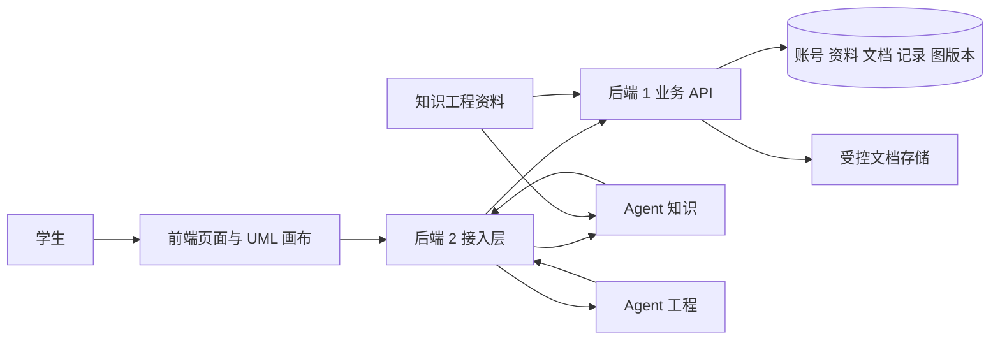
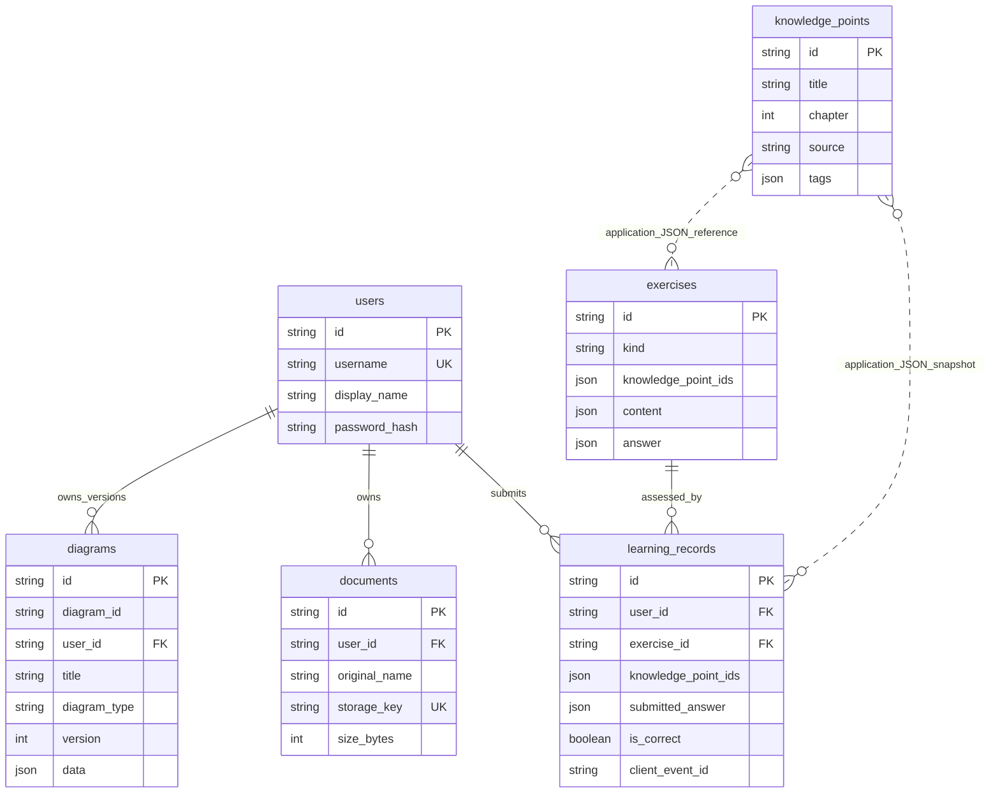
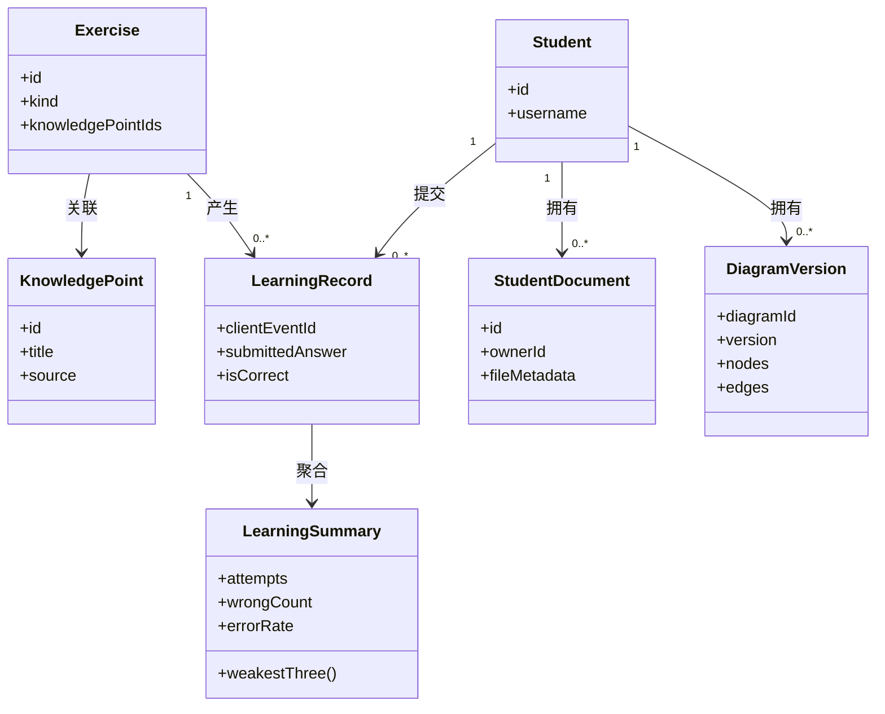

# 知构业务后端需求与数据库设计

版本：v1.0

日期：2026 年 10 月 21 日

适用范围：第一次团队作业的后端需求、数据设计及后续实现验收

知构面向正在学习《软件工程》课程的学生，围绕概念问答、需求建模、文档评审、测试陪练和学情诊断组织学习活动。业务后端负责保存这些活动所需的账号、课程资料、学生文档、答题记录和 UML 图版本，使学生可以继续上次的学习，并让学情结论有可核对的数据依据。

本次后端范围是账号认证、课程资料查询、文档保存、图数据与版本管理、练习答题和学情统计。Agent 的检索生成、文档评审、代码沙箱、队列与生产部署由对应成员负责。本文件可以作为团队总需求文档的后端章节；团队标志、真实调研记录、完整前端设计和领域定制效果对比仍需在团队总文档中共同呈现。

## 1 版本与依据

### 1.1 迭代记录

| 版本 | 日期 | 变更内容 | 变更依据 |
| --- | --- | --- | --- |
| v1.0 | 2026-10-21 | 建立业务后端范围、六张表、统计规则、版本规则和可执行验收要求 | 课程第一次作业、组内分工说明、现有知识工程资料、团队仓库目录约定 |

此表只记录已经形成的文档版本。后续字段变更、联调问题和需求调整应记录实际日期、影响接口及确认结果，不预填“已联调通过”。

### 1.2 需求来源

1. [课程第一次团队作业](https://edu.cnblogs.com/campus/fzu/2026-01SoftwareEngineeringandSoftwareEngineeringPractice/homework/16759)要求描述前后端、领域知识来源、智能体任务、定制方法、用户操作关系与验收标准，强调核心流程真实可用。
2. 组内《具体工作说明》将后端 1 定义为业务接口与数据库负责人，明确六类数据、注册登录、知识点与案例查询、上传文档、保存读取图、记录答题、OpenAPI 和薄弱知识点统计。
3. 团队仓库约定业务后端置于 `backend/`，接口、UML 数据格式和需求说明置于 `docs/`。当前示例采用 Python 后端启动方式，并预留 PostgreSQL 数据库配置。
4. 现有知识工程资料包含60个知识点、20个需求案例、3套评审清单、6张UML图片以及10对埋雷文档与标准问题清单，原资料由独立的[知识工程PR #1](https://github.com/52HzWhale111/agent/pull/1)管理。本次后端PR不重复提交原资料，只提供其中知识点和案例的结构化快照`backend/data/knowledge_snapshot.json`，用于独立初始化。这些资料提供课程范围和导入结构，不能代替目标用户访谈。

文档组织参考 [GB/T 9385-2008 计算机软件需求规格说明规范](https://openstd.samr.gov.cn/bzgk/gb/newGbInfo?hcno=2790825C43AD0B69E3C38C140BFFCFE6)。2026 年 10 月 21 日查询的官方页面标示该标准为现行。本文件是课程项目的需求与设计材料，不作已完成标准逐条符合性审查的声明。

### 1.3 调研边界与待验证问题

目前能够确认的是课程要求、组内分工与资料结构，尚无可引用的真实用户访谈、问卷样本或课堂观察记录，因此本文件不编造人数、比例或“学生普遍反馈”。团队调研可重点验证：学生最需要保存哪些学习结果；掌握度按题目正确率展示是否容易理解；UML 冲突时是否能接受重新加载后再保存；推荐练习是否与近期学习内容相符。获得证据后，应把调研结论关联到下方需求编号。

## 2 用户与使用场景

| 使用者 | 典型场景 | 业务后端需要支持的结果 |
| --- | --- | --- |
| 首次使用的学生 | 注册后浏览软件工程知识点和案例 | 成功登录；无学习记录时返回明确空状态，不生成虚假的薄弱点 |
| 正在练习的学生 | 作答后查看解析，再回到历史记录复习 | 后端评分并保存一次作答；重试不重复计数 |
| 正在建模的学生 | 保存类图，关闭页面后继续修改 | 恢复节点、连线和布局；保留历史版本 |
| 多标签页使用的学生 | 两个页面同时修改同一张图 | 旧版本保存被识别为冲突，避免覆盖较新的修改 |
| 上传课程文档的学生 | 上传需求规格说明书供评审 | 文档与所有者关联；可读取自己的原文件，其他账号无权访问 |
| 前端、后端 2 与 Agent 成员 | 联调知识查询、文档评审与建模流程 | 有稳定字段、明确状态码、请求追踪标识及可重建测试数据 |

## 3 系统边界与协作流程

### 3.1 组成与责任



独立运行时，前端或 Swagger 可直接调用业务 API 完成后端范围的流程。接入层集成后，网关转发业务请求及学生的 Bearer Token；后端仍以 Token 中的用户身份判断所有权。不能仅凭前端或网关传入的 `user_id` 决定访问权限。

| 模块 | 本次后端 1 职责 | 交接对象与边界 |
| --- | --- | --- |
| 账号 | 注册、登录、密码哈希、Token 校验、当前用户 | 前端使用统一认证字段；后端 2 透传认证信息 |
| 课程资料 | 结构化导入、知识点和案例查询、保留来源文字 | 知识工程负责内容正确性与资料授权；Agent 负责检索和回答 |
| UML | 保存 JSON、读取历史、校验基础结构、并发冲突检测 | 前端 2 负责画布交互、布局和 PNG/SVG 导出；Agent 工程负责语义一致性 |
| 文档 | 受限上传、文件归属、元数据和原文件读取 | 后端 2 接入上传链路；Agent 知识负责解析、评审与问题定位 |
| 学习 | 自动评分、答题记录、按知识点统计、推荐练习 | 前端展示结果；Agent 诊断能力后续可使用受控的学生数据 |
| 上线 | 提供数据库配置和运行入口 | 后端 2 负责 Compose、HTTPS、备份、监控、生产地址 |

### 3.2 与领域智能体的关系

业务后端的价值在于提供可追溯的数据基础。问答页面读取知识点和来源；建模页面读取案例、保存图版本；文档评审链路先获得本人的文档，再由接入层调用知识 Agent；测试陪练由接入层调用沙箱；学情页读取已评分作答的统计结果。知识库查询、数据库检索和错误率计算本身不等同于已完成领域 Agent 定制。

领域定制的最终验收还需由 Agent 成员提供相同输入下的对比：通用回答与基于课程资料回答的知识正确性、出处准确性；需求拆解的角色与异常流完整度；埋雷文档的检出与误报情况。业务后端应能保存或定位其输入对象，但本次不虚报这些实验已经完成。

## 4 功能需求

P0 表示演示与核心学习流程必须具备；P1 表示对联调和复习有直接帮助。

| 编号 | 优先级 | 需求与可观察结果 | 主要数据 |
| --- | --- | --- | --- |
| BE-FR-01 | P0 | 学生使用唯一用户名注册并登录；成功返回限时 Token，失败返回明确错误 | users |
| BE-FR-02 | P0 | 已认证学生只能访问自己的文档、答题记录和图；替换他人对象 ID 不能获得内容 | users、documents、learning_records、diagrams |
| BE-FR-03 | P0 | 查询知识点列表及详情，保留课程分章、定义、例子、常见错误、来源和标签 | knowledge_points |
| BE-FR-04 | P0 | 查询需求案例及练习详情；案例保留背景、角色、功能、流程和答案要点等原有内容 | exercises |
| BE-FR-05 | P0 | 上传允许格式且不超过 20 MiB 的文件；成功产生本人的文档记录，并可读取原文件 | documents、文件存储 |
| BE-FR-06 | P0 | 创建三类 UML 图，保存节点、连线、位置及属性；重新读取与保存结果一致 | diagrams |
| BE-FR-07 | P0 | 每次成功保存图产生新版本；历史仍可读取；旧版本不能覆盖较新版本 | diagrams |
| BE-FR-08 | P0 | 对自动评分练习提交选项；正确性由服务端题库判定，返回解析并保存记录 | exercises、learning_records |
| BE-FR-09 | P0 | 对同一学生的相同答题事件重试，不产生第二条记录；相同事件号配不同内容应报冲突 | learning_records |
| BE-FR-10 | P0 | 按实际作答计算知识点错误率并给出最多三个薄弱点；未作答知识点不能按错误率零排名 | knowledge_points、learning_records |
| BE-FR-11 | P1 | 给出五道可作答练习；优先覆盖薄弱知识点，数量不足时清楚标明补充或基础练习 | exercises、learning_records |
| BE-FR-12 | P1 | 查询本人的学习历史和图列表，便于返回继续学习；列表具备明确空结果 | learning_records、diagrams |
| BE-FR-13 | P0 | 运行服务时自动提供 Swagger UI 与 OpenAPI；静态接口材料由同一实现导出 | OpenAPI |
| BE-FR-14 | P0 | 从现有资料导入 60 个知识点和 20 个案例，重复执行不会产生重复记录 | knowledge_points、exercises |

题库中 `case` 表示开放式需求案例，`question` 表示能够由服务端判定选项的练习。开放式案例没有可靠的单一正确选项，不能直接当成选择题评分；需要 Agent 评审时进入对应 Agent 链路。

### 4.1 注册与登录用例

前置条件：业务服务和数据库可用。学生提交用户名、显示名称与密码，后端验证格式并以规范化用户名检查重复，保存密码哈希；登录验证通过后返回 Token。后续请求携带 `Authorization: Bearer <token>`。

异常流程：用户名已存在时返回冲突；密码或用户名不匹配时使用统一认证失败提示；缺失、无效或过期 Token 返回未认证错误。响应中不得包含密码、密码哈希或签名密钥。

### 4.2 保存与恢复图用例

1. 学生打开案例或已有图，前端获得 `diagram_id`、当前 `version` 与图数据。
2. 学生修改节点、连线或布局，前端保留其当前编辑内容。
3. 创建新图时后端分配逻辑图 ID 并保存第 1 版。更新已有图时，前端同时提交它基于的版本。
4. 后端校验所有者、图类型、节点和连线结构，再确认提交的基础版本仍是最新版本。
5. 成功后追加下一版，并返回新的版本号；之后重新打开可以恢复该版本。

异常流程：重复节点 ID、重复边 ID、引用不存在节点的连线或非法图类型被拒绝；对象不属于当前学生时不返回其数据；发生版本冲突时返回 HTTP 409。前端保留未保存内容，提示重新加载或人工合并，不自动清空编辑器。读取历史版本不会改变当前版本；要以历史内容继续编辑，需要基于当前最新版本另存一次。

### 4.3 答题与学情用例

学生获取练习后提交题目 ID、所选答案与唯一事件号。后端从题库读取标准选项、知识点标签并评分，在同一事务中保存作答结果。学生随后查看历史记录和学情页；统计只读取该学生的有效作答数据。客户端提供的“正确与否”或任意知识点标签不作为评分依据。

网络重试时，客户端复用原事件号；下一次真实作答使用新事件号。这样既避免一次点击被统计两次，又保留学生再次练习产生的真实记录。若事件号相同但题目或答案发生变化，后端返回冲突。

## 5 数据库设计

### 5.1 技术与设计取舍

使用 SQLAlchemy 2 管理模型和事务。本地演示使用 SQLite，减少准备数据库服务的步骤；PostgreSQL 作为部署配置，需在团队实际环境执行初始化、回归和备份恢复验证。SQLite 上通过的结果不应被写成 PostgreSQL 已验证。

本版本保留六张物理表，与组内分工一致。课程案例和自动评分练习共同存放在 `exercises`，通过类型区分。每次图版本是一条 `diagrams` 记录，逻辑图 ID 将多个版本归为一张图，因此无需额外增加版本表。采用 UUID 的对象主键不代表可跳过权限检查。

知识点关联以 JSON ID 数组保存，便于与现有题库交接。该部分是应用层引用，不是数据库外键；导入和作答必须验证关联 ID，不能在 ER 图中误标为物理外键关系。若后续需要大量标签分析、多课程共享或复杂关联查询，可通过正式迁移引入关联表。

### 5.2 六张表的职责与主要字段

最终物理类型、约束名与完整字段以 `backend/app/models.py` 和导出的建表脚本为准。本表解释字段的业务含义。

| 表 | 关键字段 | 数据规则 |
| --- | --- | --- |
| users | id、username、display_name、password_hash | 用户名唯一；密码只保存 Argon2 哈希；个人对象通过 user_id 关联用户 |
| knowledge_points | id、title、chapter、definition、example、common_mistake、source、tags、difficulty、related_features、source_file | 保留 KP-01 至 KP-60 的稳定 ID；课程分章与来源中的教材章节分别保存 |
| exercises | id、kind、title、knowledge_point_ids、content、answer、source_file | RC 案例与 Q 练习分开编码；开放案例答案要点和评分练习答案用途不同；正常练习查询不泄露标准选项 |
| documents | id、user_id、original_name、storage_key、media_type、size_bytes、sha256、status、created_at | 元数据与文件内容关联；服务端决定存储位置；对原文件访问执行所有者检查 |
| learning_records | id、user_id、exercise_id、knowledge_point_ids、submitted_answer、is_correct、activity_type、client_event_id、created_at | 固化作答时知识点标签；同一用户事件号唯一；正确性由后端计算 |
| diagrams | id、diagram_id、user_id、title、diagram_type、version、data、created_at | id 为版本行主键；diagram_id 为逻辑图 ID；同一图版本号唯一；已存版本不被更新覆盖 |

时间在后端使用 UTC 保存和交换，前端按 Asia/Shanghai 显示。不能使用格式化后的本地时间字符串进行排序或版本判断。

### 5.3 实体关系图



虚线关系表示 JSON 中保存的知识点 ID 引用，实线关系表示用户或练习外键关系。`diagrams` 的唯一键是 `(diagram_id, version)`；学习记录的幂等唯一键是 `(user_id, client_event_id)`。`storage_key` 属于后端存储实现，不在文档元数据响应中公开。

### 5.4 领域类图



`LearningSummary` 是查询得到的统计结果，不是新增数据库表；`DiagramVersion` 对应 `diagrams` 的一条版本记录。

## 6 关键业务规则

### 6.1 图 JSON 与版本

数据分为 `nodes` 和 `edges`。节点包含稳定 ID、类型、名称、位置及可扩展属性；连线包含稳定 ID、起点、终点、类型和名称。前端保存位置与属性，才能在重新打开后恢复学生的编辑结果。用例图、类图和时序图分别使用 `use_case`、`class`、`sequence`。

数据库对同一逻辑图的版本号设置唯一约束。业务层发现基础版本已过期，或并发提交触发版本唯一性冲突时，返回 409，由调用方保留内容并处理冲突。版本号不由前端自行决定，服务端成功提交后才产生新版本。业务后端的结构校验不替代 UML 语义校验和图代码一致性检查。

### 6.2 薄弱知识点计算

对当前学生、每个实际作答过的知识点 k：

```text
attempts(k) = 带有知识点 k 标签的有效作答次数
wrong(k)    = 其中 is_correct 为 false 的次数
error_rate(k) = wrong(k) / attempts(k)
mastery(k)    = 1 - error_rate(k)
```

按 `error_rate` 降序、`attempts` 降序、知识点 ID 升序排序，取前三项作为薄弱知识点。最后一个排序条件使相同数据的返回次序稳定。学情接口的 `min_attempts` 默认值为 1，可用于排除样本量不足的知识点；返回全部知识点的统计与最多三个符合阈值的薄弱点。一题关联多个知识点时，该次作答对每个标签分别计一次，界面不应把各知识点次数简单相加解释为独立题数。

例如 KP-A 作答 4 次错 3 次，KP-B 作答 2 次错 1 次，KP-C 作答 6 次错 3 次，则排序为 A、C、B。未作答知识点的掌握度为未知，不作为零错误率的“已掌握”知识点。只有一个已作答知识点时最多返回一个薄弱点；空记录账号返回空薄弱点列表。

该掌握度是当前题库作答正确率指标，不能解释为对学生真实能力的完整测量，也不用于课程成绩或个人评价。练习推荐以可解释的规则优先选择薄弱知识点题目，并通过返回信息区分针对性练习与补充练习。

### 6.3 文档上传

允许的后缀为 `.doc`、`.docx`、`.pdf`、`.zip`，单文件上限 20 MiB，即 20 × 1024 × 1024 字节。后端检查允许格式、文件特征与大小，使用随机存储名，原始文件名仅用于显示和下载。后端不得直接拼接用户文件名形成服务器路径。

此接口负责保存文件，不执行 ZIP 内代码，也不承担 Word/PDF 内容解析、病毒扫描和 Agent 评审。接入层部署时还需要限制请求体大小；业务服务对已接收文件的限制不能替代入口服务器的传输限制。私有文件不能通过无鉴权静态目录暴露。

### 6.4 知识库导入与来源

导入按稳定资料ID更新或补齐，重复导入保持记录数量稳定，不重建学生账号或清空学习记录。初始化优先读取根`knowledge-base/`的原资料，兼容早期资料包的`knowledge-base/knowledge-base/`布局；没有可用原资料目录时，从`backend/data/knowledge_snapshot.json`读取同批60个知识点和20个案例。原资料来源见知识工程PR #1，本次不把该PR描述为已经合并。快照保留资料文件名与来源原文，便于知识工程修正；课程分章是资料组织方式，不能自动改写成教材章节。

现有 60 条知识点有来源文字，但未附教材和课件原文件，因此页码真实性尚不能核验；KP-59 的来源缺少页码。20 个案例未提供逐条出处与知识点关联，后端不得编造。3 套资料实际为评审结构和评分点清单，6 张 PNG 是展示图，不能直接当作可编辑 JSON。独立准备的演示图和自编练习必须标明其性质。埋雷文档只用作负面测试资料，不导入正常知识点或练习标准答案。

## 7 非功能需求

本节为验收要求，实际达成情况以测试记录为准。

| 编号 | 要求 | 检查方式 |
| --- | --- | --- |
| BE-NFR-01 | 密码采用 Argon2 哈希；签名密钥从配置读取，生产环境不得沿用演示值 | 检查用户响应、数据库字段与配置；错误密钥和过期 Token 不被接受 |
| BE-NFR-02 | 文档、图与学习记录在每次访问时校验当前用户 | 使用两个账号交换对象 ID，内容不泄露 |
| BE-NFR-03 | 正常和业务错误响应有稳定结构，错误包含可识别代码，服务端失败不向客户端输出堆栈 | 检查 OpenAPI 示例与错误测试 |
| BE-NFR-04 | 多次提交旧图版本不会覆盖新版本；同一答题事件重试不增加统计次数 | 并发或顺序冲突测试；幂等测试 |
| BE-NFR-05 | 列表结果有边界与明确空值；无学习数据时不产生伪造诊断 | 新账号与参数边界测试 |
| BE-NFR-06 | 默认本地运行不依赖外部 Agent 或模型 API Key，核心业务接口可独立演示 | 在不启动 Agent 的情况下执行后端验收 |
| BE-NFR-07 | 文件超过限制或格式不匹配时拒绝保存，不留下可访问的不完整文件 | 大文件、非法文件和失败清理测试 |
| BE-NFR-08 | 初始化和种子数据可重复执行，示范账号只在显式启用演示数据时创建 | 空库初始化和二次导入计数对比 |
| BE-NFR-09 | 本地可重建数据库、API 文档和测试资料；迁移部署配置后重新验证 | 按 backend/README.md 从空环境运行；保存命令结果 |

本次不承诺未经压测的并发量或响应时延。后端 2 的 Agent 超时、队列、HTTPS、备份与监控指标应记录在部署与集成文档中，不能由本地数据库测试代为证明。

## 8 需求与验收追踪

| 验收编号 | 对应需求 | 输入或操作 | 应观察到的结果 |
| --- | --- | --- | --- |
| AC-01 | FR-01、NFR-01 | 注册新用户，重复注册，正确和错误密码登录 | 注册成功；重复冲突；正确登录返回 Token；错误密码返回未认证错误且无密码字段 |
| AC-02 | FR-02、NFR-02 | 用户 B 请求用户 A 的图、文档或学习数据 | 不返回 A 的私有内容；B 只能得到自己的记录 |
| AC-03 | FR-03、FR-04、FR-14 | 执行导入两次，查询 KP-01 与 RC-01 | 60 个知识点和 20 个案例保持稳定；来源及案例原有字段可读取 |
| AC-04 | FR-05、NFR-07 | 上传合法小文件，再上传非法类型与超限文件 | 合法文件可由本人下载；非法输入被拒绝；无残留私有文件暴露 |
| AC-05 | FR-06 | 保存三种图并重新读取 | 节点、边、位置及属性与保存值一致 |
| AC-06 | FR-07、NFR-04 | 创建 v1，基于 v1 保存 v2，再基于 v1 提交 | v1 与 v2 可读取；第三次返回 409，v2 保持不变 |
| AC-07 | FR-08、FR-09 | 提交一道已知选项题；相同事件重试；同事件改变答案 | 后端评分正确；重试只有一条记录；修改内容返回冲突 |
| AC-08 | FR-10、NFR-05 | 新账号查学情；有记录账号查统计；核算题目标签与对错 | 新账号无伪造薄弱点；错误率、同分排序和最多三项一致 |
| AC-09 | FR-11 | 有薄弱点与无记录账号分别请求练习 | 返回可作答练习；来源和推荐性质可解释；题面不暴露标准选项 |
| AC-10 | FR-12 | 查看个人历史与图列表，切换账号重查 | 列表对应当前用户；空状态可处理；不混入其他账号内容 |
| AC-11 | FR-13、NFR-03 | 打开 Swagger 并导出 OpenAPI，核查错误示例 | 路径、请求字段与实现一致，字段无需靠聊天记录猜测 |

## 9 与团队总报告的衔接

本章提供“前后端描述”中的后端部分、持久化数据关系、用例异常流和验收依据。团队总报告仍需放入真实调研结论、项目标志、整体思维导图、完整产品类图及前端页面说明。答辩时可以用一次保存图并恢复、一次答题并刷新薄弱点说明业务闭环；Agent 定制效果则使用由对应成员实际运行的课程任务与对照结果展示。

课程页面给出的答辩日期为 2026 年 10 月 24 日，博客文字要求为 10 月 25 日，页面系统截止为 10 月 26 日 00:00。团队应以博客文字日期安排提交，并以最新课程通知确认变化。后端交付不代表整组博客已发布或整套服务已上线。
