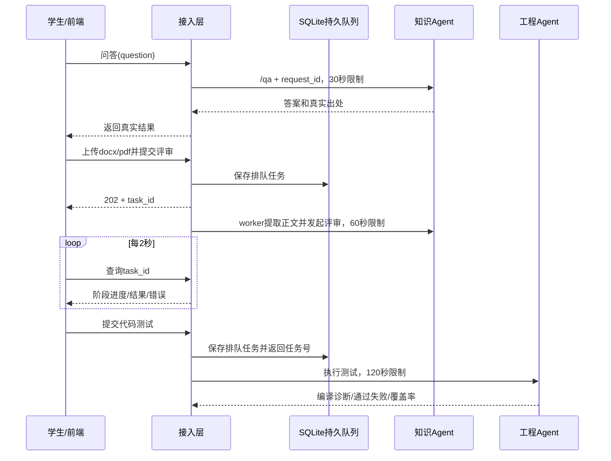

# 后端2需求与验收贡献（第一次作业）

## 迭代记录

| 日期 | 内容 | 证据 |
|---|---|---|
| 2026-10-21 | 根据组内分工实现接入、队列、上传、部署及运维交接 | 本 PR；接口、测试和部署说明 |
| 2026-10-21 | 对照课程作业要求区分已实现与待联调验收 | 本文；不虚构调研、上线或定制效果 |

本文是后端2负责部分，可并入团队需求分析文档；不替代团队完整需求规格。团队调研依据、项目标志、思维导图、领域类图、成员资料等由相关负责人补充。课程指定的《软件需求规范》国标正式版本及编号由团队核对，这里不声称整篇文档符合未经核验的标准。

## 服务对象、场景与职责

服务对象是使用《软件工程》学习软件的学生。学生通过前端完成概念问答、需求拆解、上传评审、测试代码和图代码比对。接入层负责统一调用知识 Agent 和工程 Agent、管理等待和错误、存储上传、提供运行状态。用户账号、课程数据和学习记录归后端1；领域检索/生成归知识 Agent；真实执行、覆盖率和一致性判定归工程 Agent。

图中问答响应逻辑上经网关返回；长任务完成后前端靠轮询获取结果。无硬件联动要求，不增加无关硬件功能。

## 验收标准与证据

| 编号 | 操作 | 预期 | 当前证据 |
|---|---|---|---|
| B2-01 | 发问答和需求拆解 | 路径、字段与PR #2一致，结果保持JSON对象 | 自动契约测试；真实Agent待接入 |
| B2-02 | 上游持续迟缓 | 同步请求30秒内终止；任务执行分别60/120秒内终止并显示重试提示 | 测试用缩短超时验证同一逻辑；真实耗时待联调 |
| B2-03 | 提交评审/测试，随后查询任务 | 先返回202及任务号，每2秒轮询，终态停止 | 自动测试验证排队、成功、失败 |
| B2-04 | 上传允许文件/伪后缀/超限文件/同名文件 | 限20MiB，拒绝不支持或签名不符；随机名无覆盖；失败不留半文件 | 自动上传测试 |
| B2-05 | 停工程Agent，继续调用知识功能 | 工程暂不可用；知识仍可调用；就绪接口显示降级 | 自动故障隔离测试；Compose停服演练待上线 |
| B2-06 | 排队后重启网关 | 排队继续，已完成可查询，中断运行标失败可重试 | 自动持久化与重启测试 |
| B2-07 | 云服务器重启 | Docker及服务自动恢复，公网HTTPS可访问 | 配置已交付；无服务器，未验收 |
| B2-08 | 服务故障及恢复 | 30秒检查周期后通知故障与恢复，无重复刷屏 | 监控代码与测试；通知渠道和截图待填 |
| B2-09 | 运行备份再恢复 | 业务DB、任务DB、上传均可恢复查询 | 网关SQLite与上传文件本地恢复演练通过；PostgreSQL及服务器整套待验收 |
| B2-10 | 按请求编号查日志 | 能关联入口与调用步骤，记录耗时，日志按天轮转 | 自动日志追踪验证；Agent内部步骤待队友实现 |

## 领域定制效果如何检查（团队协作）

选同一模型、相同输入，比较无资料/无工具的通用调用与知识检索+提示词/执行工具定制后的输出，保留输入、模型名、配置、原始结果和人工判定依据。建议直接使用 PR #2 的20个案例，不另外虚构“全部通过”的记录。

- 知识同学运行8个问答案例：检查知识点正确性、真实教材/课件出处、无依据内容。保存实际返回和人工核对结果。
- 需求同学运行6个拆解案例：检查角色、用例、主流程和异常流、结构化输出；比较缺失/错误点。
- 文档评审运行6个案例：按已知缺陷计算检出与误报，注明样本量和判定方式。
- 工程同学提供真实编译错误、死循环限制、通过/失败测试、覆盖率证据；不能用网关Mock测试证明代码真的编译执行。
- 后端2提供上述调用的 request_id、任务状态、耗时与异常响应，用于复现。测试报告应区分领域效果测试和基础设施测试。

真实调研对象、访谈数量、改进百分比、上线地址、测试账号均需团队实际采集，不在本次实现中编造。10月24日答辩、10月25日博客只能引用已取得的证据，其余列为计划。
